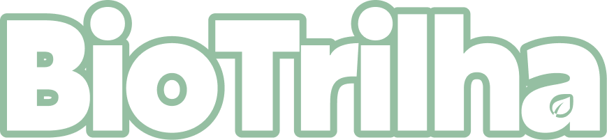
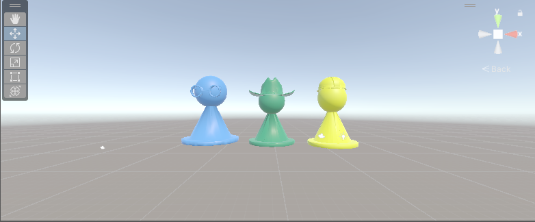
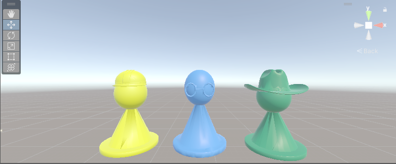
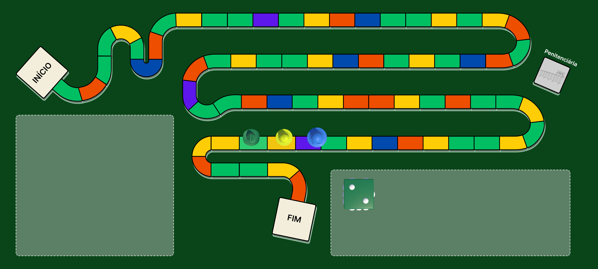
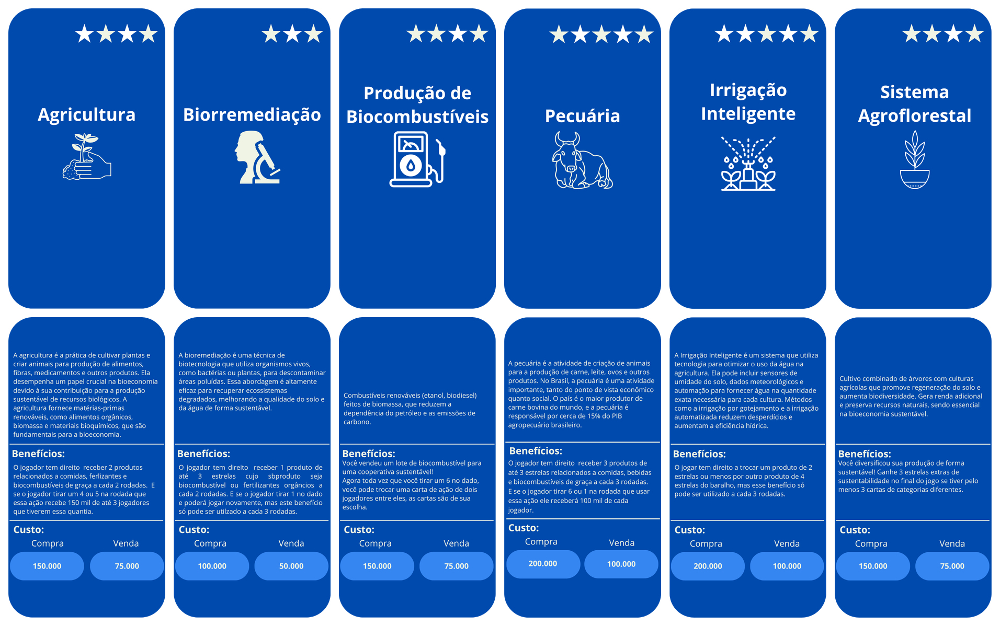

<div align="center">



# BioTrilha

*A digital board game for teaching Brazilian Bioeconomy*


</div>

---

## About the Project

**BioTrilha** is a digital board game developed for **Android mobile devices**, designed to promote environmental education and awareness about **Brazilian Bioeconomy** — covering themes such as sustainable products, biodiversity, and the economic potential of Brazil's natural biomes.

This project is the result of **years of research** and is being developed as a **Bachelor's thesis (TCC)** for the Computer Science degree at **UFOPA (Universidade Federal do Oeste do Pará)**. It is backed by a full academic article containing all game rules, visual models, and theoretical foundations.

> The game is currently in active development. The academic article is complete and serves as the primary reference for all game design decisions.

---

## Game Elements

The game features a rich set of physical and digital components:

| Element | Description |
|---|---|
| **Board** | 2D illustrated board with paths and biome regions |
| **Lucky / Penalty Cards** | Cards that trigger positive or negative events |
| **Question Cards** | Bioeconomy-themed trivia questions |
| **Product Cards** | Cards representing real Bioeconomic products from Brazilian biomes |
| **Action Cards** | Cards that alter the flow of the game |
| **Game Bills** | In-game currency in denominations of **5,000 · 10,000 · 50,000 · 100,000** |
| **Pawns** | 3D character models that move across the board |

---

## Screenshots

<div align="center">


<br/>
<sub>3D pawn models (Agrônomo, Químico, Cientista) previewed in the Unity Editor</sub>
<br/><br/>

<br/>
<sub>Current board prototype (Unity Game view, landscape): path with colored houses, START, FINISH, Penitentiary, the dice and the three pawns standing on the board</sub>
<br/><br/>

<br/>
<sub>Action card artwork (front on top, back below), exported from Canva with a transparent background. 6 of the 36 cards shown</sub>
</div>

---

## Current Status

- [x] Academic article written with full game design documentation
- [x] Game logo finalized
- [x] Board artwork (2D) added
- [x] 3D dice model added
- [x] 3D pawn models added: Engenheiro Agrônomo, Engenheiro Químico, Cientista
- [x] Action card artwork (36 cards, front and back, transparent PNG)
- [x] Luck or Setback card artwork (26 cards and a shared back, transparent PNG)
- [x] Question card artwork (47 cards and a shared back, transparent PNG)
- [ ] Product card artwork
- [ ] Banknote artwork
- [x] Unity project initialized with Android mobile configuration
- [x] Project folder structure organized
- [x] Scene folders organized: Main Menu, Standard Game, Tutorial (scenes still to be built)
- [x] Board prototype scene (`SampleScene`): board, dice and pawns
- [ ] Game logic implementation (C# scripts)
- [x] Action, Luck/Setback and Question card data (ScriptableObjects) and card UI prefabs
- [ ] Card system and deck mechanics
- [ ] In-game currency system
- [x] Board camera controller (follows the moving pawn, then shows the full board)
- [ ] Dice roll and pawn movement on the board (3D)
- [ ] Tutorial scene with animated characters (2D)
- [ ] UI/UX for mobile screens
- [ ] Audio: soundtrack and sound effects
- [ ] Build and testing on Android devices
- [ ] Full documentation (in progress)

---

## Tech Stack

| Tool | Purpose |
|---|---|
| **Unity** | Game engine (2D + 3D hybrid) |
| **C#** | Game scripting language |
| **Android** | Target platform |
| **JetBrains Rider** | Code editor (IDE) |
| **Git + GitHub** | Version control and collaboration |

---

## Project Structure

```
Assets/
├── BioTrilha/
│   ├── Animations/            # Character and pawn animations
│   ├── Art/
│   │   ├── 2D/                # Board, cards, banknotes, logo, UI sprites
│   │   │   ├── Banknotes/
│   │   │   ├── BoardGame/     # Game board artwork
│   │   │   ├── Cards/
│   │   │   │   ├── Actions/   # 36 action cards (Front/ and Back/)
│   │   │   │   ├── LuckSetback/ # 26 Luck/Setback cards (Front/) + shared back (Back/)
│   │   │   │   ├── Questions/ # 47 Question cards (Front/) + shared back (Back/)
│   │   │   │   └── Products/  # Front/back product card art
│   │   │   ├── Logo/          # Game logo
│   │   │   ├── Tutorial/
│   │   │   └── UI/
│   │   └── 3D/                # Dice and pawn models/textures
│   │       ├── Dice/
│   │       └── Pawns/
│   │           ├── Models/    # Engenheiro_Agronomo, Engenheiro_Químico, Cientista
│   │           └── Textures/
│   ├── Audio/                 # Music and sound effects
│   ├── Prefabs/                # Reusable game objects (Cards/ActionCard)
│   ├── SciptableObjects/       # Game data (Cards/Actions: 36 action card assets)
│   └── Scripts/                # C# game logic (Banknotes, Board_Game, Cards, Editor, GameManager, Pawns, Tutorial, UI)
├── Scenes/
│   ├── SampleScene             # Current board prototype (board, dice, pawns)
│   ├── Main_menu               # Folder for the main menu scene (planned)
│   ├── Standardgame            # Folder for the main board game scene (planned)
│   └── Tutorial                # Folder for the tutorial scene (planned)
└── Screenshots/                 # Development preview captures
```

---

## Contributors

<div align="center">

<!-- Author -->
<table>
  <tr>
    <td align="center">
      <a href="https://github.com/amiralo01">
        <br/>
        <sub><b>Amiraldo Ferreira</b></sub>
      </a><br/>
      <sub>Author · Developer</sub>
    </td>
    <!-- Add co-author and collaborators below following the same pattern -->
    <!-- Example:
    <td align="center">
      <a href="https://github.com/USERNAME">
        <br/>
        <sub><b>Full Name</b></sub>
      </a><br/>
      <sub>Co-author · Advisor</sub>
    </td>
    -->
  </tr>
</table>

</div>

---

## License

This project is licensed under the **MIT License**. See the [LICENSE](LICENSE) file for details.

---
---

<div align="center">


# BioTrilha

*Um jogo de tabuleiro digital para o ensino da Bioeconomia Brasileira*


</div>

---

## Sobre o Projeto

**BioTrilha** é um jogo de tabuleiro digital desenvolvido para **dispositivos móveis Android**, com o objetivo de promover a educação ambiental e a conscientização sobre a **Bioeconomia Brasileira** — abordando temas como produtos sustentáveis, biodiversidade e o potencial econômico dos biomas naturais do Brasil.

Este projeto é resultado de **anos de pesquisa** e está sendo desenvolvido como **Trabalho de Conclusão de Curso (TCC)** para o Bacharelado em Ciências da Computação na **UFOPA (Universidade Federal do Oeste do Pará)**. O projeto é sustentado por um artigo acadêmico completo contendo todas as regras do jogo, modelos visuais e fundamentação teórica.

> O jogo está atualmente em desenvolvimento ativo. O artigo acadêmico está concluído e serve como referência principal para todas as decisões de design do jogo.

---

## Elementos do Jogo

O jogo conta com um conjunto rico de componentes físicos e digitais:

| Elemento | Descrição |
|---|---|
| **Tabuleiro** | Tabuleiro ilustrado em 2D com trilhas e regiões de biomas |
| **Cartas de Sorte / Revés** | Cartas que ativam eventos positivos ou negativos |
| **Cartas de Questões** | Perguntas temáticas sobre Bioeconomia |
| **Cartas de Produtos** | Cartas representando produtos Bioeconômicos reais dos biomas brasileiros |
| **Cartas de Ação** | Cartas que alteram o fluxo do jogo |
| **Cédulas do Jogo** | Moeda do jogo nos valores de **5.000 · 10.000 · 50.000 · 100.000** |
| **Peões** | Modelos 3D de personagens que se movem pelo tabuleiro |

---

## Capturas de Tela

<div align="center">


<br/>
<sub>Modelos 3D dos peões (Agrônomo, Químico, Cientista) visualizados no Unity Editor</sub>
<br/><br/>

<br/>
<sub>Protótipo atual do tabuleiro (Game View do Unity, modo paisagem): trilha com casas coloridas, INÍCIO, FIM, Penitenciária, o dado e os três peões sobre o tabuleiro</sub>
<br/><br/>

<br/>
<sub>Arte das cartas de Ação (frente em cima, verso embaixo), exportadas do Canva com fundo transparente. 6 das 36 cartas</sub>
</div>

---

## Status Atual

- [x] Artigo acadêmico escrito com documentação completa do design do jogo
- [x] Logo do jogo finalizada
- [x] Arte do tabuleiro (2D) adicionada
- [x] Modelo 3D do dado adicionado
- [x] Modelos 3D dos peões adicionados: Engenheiro Agrônomo, Engenheiro Químico, Cientista
- [x] Arte das cartas de Ação (36 cartas, frente e verso, PNG transparente)
- [x] Arte das cartas de Sorte ou Revés (26 cartas e um verso comum, PNG transparente)
- [x] Arte das cartas de Questões (47 cartas e um verso comum, PNG transparente)
- [ ] Arte das cartas de Produto
- [ ] Arte das cédulas
- [x] Projeto Unity inicializado com configuração mobile Android
- [x] Estrutura de pastas do projeto organizada
- [x] Pastas das cenas organizadas: Menu Principal, Jogo Padrão, Tutorial (cenas ainda a construir)
- [x] Cena de protótipo do tabuleiro (`SampleScene`): tabuleiro, dado e peões
- [ ] Implementação da lógica do jogo (scripts C#)
- [x] Dados das cartas de Ação, de Sorte ou Revés e de Questões (ScriptableObjects) e prefabs de UI das cartas
- [ ] Sistema de cartas e mecânica de baralho
- [ ] Sistema de moeda do jogo
- [x] Controlador de câmera do tabuleiro (segue o peão em movimento e depois mostra o tabuleiro inteiro)
- [ ] Rolagem do dado e movimentação dos peões no tabuleiro (3D)
- [ ] Cena de tutorial com personagens animados (2D)
- [ ] UI/UX para telas mobile
- [ ] Áudio: trilha sonora e efeitos sonoros
- [ ] Build e testes em dispositivos Android
- [ ] Documentação completa (em andamento)

---

## Tecnologias Utilizadas

| Ferramenta | Finalidade |
|---|---|
| **Unity** | Engine do jogo (híbrido 2D + 3D) |
| **C#** | Linguagem de programação do jogo |
| **Android** | Plataforma alvo |
| **JetBrains Rider** | Editor de código (IDE) |
| **Git + GitHub** | Controle de versão e colaboração |

---

## Estrutura do Projeto

```
Assets/
├── BioTrilha/
│   ├── Animations/            # Animações de personagens e peões
│   ├── Art/
│   │   ├── 2D/                # Tabuleiro, cartas, cédulas, logo, sprites de UI
│   │   │   ├── Banknotes/
│   │   │   ├── BoardGame/     # Arte do tabuleiro
│   │   │   ├── Cards/
│   │   │   │   ├── Actions/   # 36 cartas de Ação (Front/ e Back/)
│   │   │   │   ├── LuckSetback/ # 26 cartas de Sorte ou Revés (Front/) + verso comum (Back/)
│   │   │   │   ├── Questions/ # 47 cartas de Questões (Front/) + verso comum (Back/)
│   │   │   │   └── Products/  # Arte das cartas (frente/verso)
│   │   │   ├── Logo/          # Logo do jogo
│   │   │   ├── Tutorial/
│   │   │   └── UI/
│   │   └── 3D/                # Modelos e texturas do dado e dos peões
│   │       ├── Dice/
│   │       └── Pawns/
│   │           ├── Models/    # Engenheiro_Agronomo, Engenheiro_Químico, Cientista
│   │           └── Textures/
│   ├── Audio/                 # Músicas e efeitos sonoros
│   ├── Prefabs/                # Objetos reutilizáveis do jogo (Cards/ActionCard)
│   ├── SciptableObjects/       # Dados do jogo (Cards/Actions: 36 assets de cartas de Ação)
│   └── Scripts/                # Lógica C# do jogo (Banknotes, Board_Game, Cards, Editor, GameManager, Pawns, Tutorial, UI)
├── Scenes/
│   ├── SampleScene             # Protótipo atual (tabuleiro, dado, peões)
│   ├── Main_menu               # Pasta da cena do menu principal (planejada)
│   ├── Standardgame            # Pasta da cena principal do tabuleiro (planejada)
│   └── Tutorial                # Pasta da cena do tutorial (planejada)
└── Screenshots/                 # Capturas de desenvolvimento
```

---

## Colaboradores

<div align="center">

<!-- Autor -->
<table>
  <tr>
    <td align="center">
      <a href="https://github.com/amiralo01">
        <br/>
        <sub><b>Amiraldo Ferreira</b></sub>
      </a><br/>
      <sub>Autor · Desenvolvedor</sub>
    </td>
    <!-- Adicione coautor e colaboradores abaixo seguindo o mesmo padrão -->
    <!-- Exemplo:
    <td align="center">
      <a href="https://github.com/USERNAME">
        <br/>
        <sub><b>Nome Completo</b></sub>
      </a><br/>
      <sub>Coautor · Orientador</sub>
    </td>
    -->
  </tr>
</table>

</div>

---

## Licença

Este projeto está licenciado sob a **Licença MIT**. Veja o arquivo [LICENSE](LICENSE) para mais detalhes.